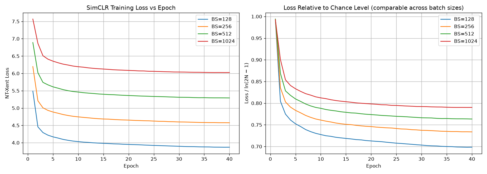
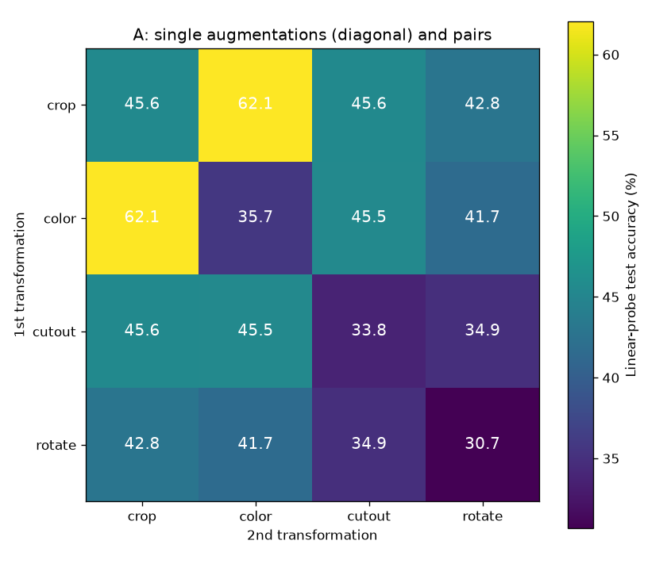
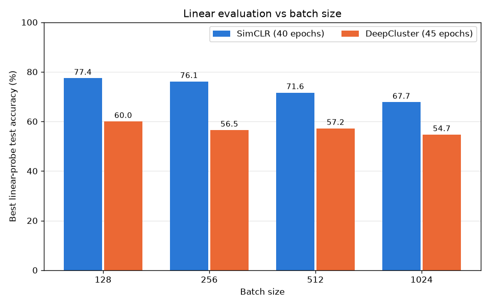

# SimCLR & DeepCluster on CIFAR-10

Topics in ML, Assignment 2: implement **SimCLR** and **DeepCluster** on the same ResNet-18 backbone and analyse the role of **augmentations**, **training duration** and **batch size**, then compare the two methods.

Everything is in one notebook, [`SimCLR_DeepCluster_CIFAR10.ipynb`](SimCLR_DeepCluster_CIFAR10.ipynb). This README maps out the notebook, describes each experiment and points to its results.

## Contents

- [Repository layout](#repository-layout)
- [Notebook guide](#notebook-guide)
- [Shared setup](#shared-setup)
- [Experiment 1: SimCLR, batch size](#experiment-1-simclr-batch-size)
- [Experiment 2: SimCLR, augmentations](#experiment-2-simclr-augmentations)
- [Experiment 3: DeepCluster, batch size and training duration](#experiment-3-deepcluster-batch-size-and-training-duration)
- [Experiment 4: DeepCluster, augmentations](#experiment-4-deepcluster-augmentations)
- [Where SimCLR and DeepCluster are compared](#where-simclr-and-deepcluster-are-compared)
- [Running the notebook](#running-the-notebook)

## Repository layout

| Path | Contents |
|---|---|
| `SimCLR_DeepCluster_CIFAR10.ipynb` | The notebook, with outputs |
| `results/` | All saved figures (and one CSV), one folder per experiment |
| `checkpoints/*/results.json` | Per-run results: config, per-epoch history, linear-probe accuracy, training time |
| `wandb/run-20261029_012321-ll1rw0m7/files/wandb-summary.json` | Saved summary of the SimCLR batch-size run (read by cells 40 and 50) |

Model weights (`checkpoints/**/*.pt`, 45 MB each) are not in the repository.

## Notebook guide

Cell numbers count every cell from the top of the notebook, starting at 1.

| Cells | Section | What it does |
|---|---|---|
| 1–2 | Title | Task statement |
| 3–7 | 1. Setup & download | Downloads the CIFAR-10 Python archive from a mirror, checks it against the official MD5 and unpacks it under `~/data/cifar` |
| 8–9 | 1.2 Imports & device check | Imports, GPU check |
| 10–13 | 2. Dataset exploration | Images per class, sample images |
| 14–16 | 3. Data on the GPU | Loads all 60k images into GPU memory as `uint8`; `GPULoader` serves batches from there; train/test loaders used by every linear probe |
| 17–21 | 4. ResNet-18 backbone | CIFAR variant of ResNet-18, no pretrained weights |
| 22–25 | 5. SimCLR, 5.1 augmentations | `build_gpu_transform`: the augmentation pipeline (Kornia, on the GPU) and a visualisation of augmented pairs |
| 26–29 | 5.2 model, 5.3 loss | `SimCLRModel` (encoder + projection head) and the NT-Xent loss |
| 30–33 | 5.4 training loop | `train_simclr`; cell 33 trains a single SimCLR model (`SIMCLR_EPOCHS = 1`, a quick check) |
| 34–35 | Linear evaluation | `train_linear_classifier`: the linear probe on frozen features used by every experiment |
| 36–40 | Role of batch size | [Experiment 1](#experiment-1-simclr-batch-size) |
| 41–46 | Augmentation experiments | [Experiment 2](#experiment-2-simclr-augmentations) |
| 47–51 | 6. DeepCluster | [Experiment 3](#experiment-3-deepcluster-batch-size-and-training-duration) |
| 52–57 | DeepCluster augmentation experiments | [Experiment 4](#experiment-4-deepcluster-augmentations) |

## Shared setup

These choices are the same for every experiment, so results can be compared across experiments and between the two methods:

- **Data:** CIFAR-10, 50k training and 10k test images, kept at 32×32.
- **Backbone:** ResNet-18 trained from scratch, with the usual CIFAR change: the first layer is a 3×3 convolution with stride 1 and the initial max-pool is removed. The encoder outputs 512-d features (after average pooling).
- **Augmentations** run on the GPU with Kornia, with random parameters for every image.
- **Linear evaluation:** the encoder is frozen, its features are extracted for the train and test sets, and a linear classifier is trained on them for 100 epochs (SGD, LR 0.3, momentum 0.9). The **best** accuracy reported below is the highest test accuracy over those 100 epochs; the accuracy after the last epoch is saved as `final_test_acc` in every `results.json`.
- **Logging:** every experiment run is logged to Weights & Biases (loss and diagnostics per step and per epoch). The projects are listed under each experiment.
- **Hardware:** one NVIDIA RTX 5080 Laptop GPU (16 GB). Training times below are for that GPU.

## Experiment 1: SimCLR, batch size

**Cells 36–40.** Question: how does the batch size (number of negatives) affect SimCLR?

| Cell | Role |
|---|---|
| 37 | Trains SimCLR for batch sizes 128, 256, 512 and 1024, 40 epochs each, then runs the linear probe on each (about 1 h 45 min in total) |
| 38 | Loss per epoch for each batch size (matplotlib) |
| 39 | The same curves and the accuracy per batch size as W&B charts |
| 40 | Rebuilds the results from the saved W&B summary, so cells 38–39 can be run without retraining |

**Setup:** augmentation `build_gpu_transform(s=0.5)`: random resized crop (area 0.2–1), horizontal flip, color jitter (0.4s, 0.4s, 0.4s, 0.1s) with probability 0.8, grayscale with probability 0.2. Adam with LR 3e-4 and weight decay 1e-4 for every batch size, linear warmup then cosine decay, temperature 0.5. With a fixed number of epochs, larger batches take fewer optimizer steps (390 per epoch at batch size 128, 48 at 1024).

**W&B project:** `simclr-batch-size`

**Results (best linear-probe test accuracy, 40 epochs):**

| Batch size | 128 | 256 | 512 | 1024 |
|---|---|---|---|---|
| SimCLR | 77.40% | 76.09% | 71.62% | 67.73% |

Figures: [`results/simclr_loss_vs_epoch_all_batch_sizes.png`](results/simclr_loss_vs_epoch_all_batch_sizes.png), [`results/simclr_loss_vs_epoch_per_batch_size.png`](results/simclr_loss_vs_epoch_per_batch_size.png); per-epoch losses in [`results/simclr_batch_size_loss_vs_epoch.csv`](results/simclr_batch_size_loss_vs_epoch.csv).



## Experiment 2: SimCLR, augmentations

**Cells 41–46**, following §3 of the SimCLR paper (Chen et al., 2020). Question: which augmentations does SimCLR need, and how strong should color distortion be?

| Cell | Role |
|---|---|
| 41 | Description of the experiments |
| 42 | Setup: settings, the augmentation pipelines (`build_aug_pipeline`), the LARS optimizer and `run_aug_config`, which trains, evaluates, saves and logs one configuration |
| 43 | **A — Composition:** crop, color, cutout and rotation, each alone and in every pair (10 runs; paper Figure 5) |
| 44 | **B — Color strength:** crop + color with s ∈ {0, 0.25, 0.5, 1.0} (3 new runs; s = 0.5 is A's crop + color run; paper Table 1) |
| 45 | Results: accuracy heatmap for A, accuracy vs strength for B, training curves; W&B summary run |
| 46 | **D — Why color matters:** pixel-intensity histograms of random crops of one image, without and with color distortion (no training; paper Figure 6) |

**Setup:** the paper's recipe for batch size 256: LARS with LR 0.3, momentum 0.9, weight decay 1e-6 (biases and BatchNorm excluded), warmup over the first 10% of steps then cosine decay, temperature 0.5, 20 epochs per run. Augmentations follow the paper's definitions: crop area 0.08–1; color = jitter (0.8s, 0.8s, 0.8s, 0.2s) with probability 0.8 plus grayscale with probability 0.2, s = 0.5 by default; cutout = a square erased patch; rotation by 90°, 180° or 270°. Horizontal flip is always on. All runs share the same initialisation. Each run takes 10–15 minutes of training.

**W&B project:** `simclr-augmentations` (groups `experiment-A`, `experiment-B`, `experiment-D`, `summary`). Saved results: `checkpoints/augmentations/results.json`.

**Results, A** (best linear-probe test accuracy; diagonal = one augmentation, off-diagonal = the pair):

| | crop | color | cutout | rotate |
|---|---|---|---|---|
| **crop** | 45.63% | 62.06% | 45.55% | 42.84% |
| **color** | | 35.71% | 45.46% | 41.66% |
| **cutout** | | | 33.83% | 34.95% |
| **rotate** | | | | 30.68% |

**Results, B** (crop + color):

| Color strength s | 0 | 0.25 | 0.5 | 1.0 |
|---|---|---|---|---|
| SimCLR | 52.41% | 61.46% | 62.06% | 59.25% |

With s = 0 the color jitter is off but random grayscale still applies.

Figures in [`results/augmentations/`](results/augmentations/): `A_heatmap.png`, `B_color_strength.png`, `training_curves.png`, `D_color_histograms.png`.



## Experiment 3: DeepCluster, batch size and training duration

**Cells 47–51.** DeepCluster (Caron et al., 2018) implemented with the same backbone, augmentations, batch sizes and linear probe as SimCLR in Experiment 1.

| Cell | Role |
|---|---|
| 47 | Description of the method and the setup |
| 48 | Setup: `DeepClusterModel`, PCA whitening, GPU k-means, the cluster-balanced loader, `train_deepcluster` and `run_deepcluster` |
| 49 | Trains DeepCluster for batch sizes 128, 256, 512 and 1024 for `DC_EPOCHS` epochs, then runs the linear probe |
| 50 | Results: training curves per batch size and linear-probe accuracy next to SimCLR's; W&B summary run |
| 51 | Example clusters: the purest and least pure clusters of the batch-size-256 model |

**Method, every epoch:** extract the features of all 50k training images (no augmentation) → PCA-whiten to 256 dimensions and L2-normalise → k-means with k = 100 clusters (10× the number of classes) → re-initialise the linear top layer → train for one epoch with cross-entropy on the cluster ids, sampling images uniformly over clusters. Labels are never used for training.

**Setup:** augmentation `build_gpu_transform(s=0.5)` (the same as Experiment 1), one view per image. The paper's Sobel filter is left out because it would change the backbone's input layer. SGD with momentum 0.9 and weight decay 1e-5; LR 0.05 at batch size 256, scaled linearly with batch size (0.025 / 0.05 / 0.1 / 0.2) and kept constant.

**Diagnostics** (the paper's): NMI between the clusters and the true labels (how semantic the clusters are) and NMI between consecutive epochs' clusterings (how stable they are).

**Training duration:** `run_deepcluster` can continue a saved run. Raising `DC_EPOCHS` and re-running cell 49 trains only the extra epochs, and the shorter run is kept in its own folder. The saved results are:

| Folder | Epochs |
|---|---|
| `checkpoints/deepcluster_1epoch/` | 1 (first test runs) |
| `checkpoints/deepcluster_15epochs/` | 15 |
| `checkpoints/deepcluster/` | 45 (epochs 16–45 continued from the 15-epoch weights) |

**W&B project:** `deepcluster-batch-size` (group `batch-size`; continued runs are named like `deepcluster_bs128_epochs16-45`).

**Results** (best linear-probe test accuracy; SimCLR from Experiment 1):

| Batch size | DeepCluster, 1 epoch | DeepCluster, 15 epochs | DeepCluster, 45 epochs | SimCLR, 40 epochs |
|---|---|---|---|---|
| 128 | 41.63% | 51.88% | 59.98% | 77.40% |
| 256 | 42.85% | 50.69% | 56.50% | 76.09% |
| 512 | 41.28% | 50.87% | 57.20% | 71.62% |
| 1024 | 40.37% | 48.19% | 54.66% | 67.73% |

After 45 epochs the NMI between the final clusters and the true labels is 0.230 / 0.200 / 0.204 / 0.202 for batch sizes 128 / 256 / 512 / 1024. Training took 18–22 minutes per batch size for 45 epochs.

Figures in [`results/deepcluster/`](results/deepcluster/): `accuracy_vs_batch_size.png`, `training_curves.png`, `clusters_bs256.png`.



## Experiment 4: DeepCluster, augmentations

**Cells 52–57.** The SimCLR augmentation experiments repeated with DeepCluster, so the two methods can be compared configuration by configuration.

| Cell | Role |
|---|---|
| 52 | Description of the experiments |
| 53 | Setup: `run_dc_aug_config`, which trains DeepCluster with one of SimCLR's augmentation pipelines, then evaluates, saves and logs it |
| 54 | **A — Composition:** the same 10 configurations as SimCLR's A |
| 55 | **B — Color strength:** the same strengths as SimCLR's B |
| 56 | Results: SimCLR and DeepCluster heatmaps side by side, accuracy vs color strength for both methods, DeepCluster training curves; W&B summary run |
| 57 | **D — Why color matters:** compares each run's final clusters (NMI) with a k-means clustering of the images' raw color histograms and with the true labels, and shows example clusters from crop-only and crop + color training |

**Setup:** the augmentation pipelines are exactly those of Experiment 2 (`build_aug_pipeline`), with the same budget (20 epochs, batch size 256), trained with the DeepCluster recipe of Experiment 3 (LR 0.05). Clustering always uses un-augmented images, so augmentation decides which differences the network must ignore to predict an image's cluster. Each run takes about 10 minutes of training.

**W&B project:** `deepcluster-augmentations` (groups `experiment-A`, `experiment-B`, `experiment-D`, `summary`). Saved results: `checkpoints/deepcluster_augmentations/results.json`; figures: `results/deepcluster_augmentations/`.

**Results:** the runs are in progress; results will be added here.

## Where SimCLR and DeepCluster are compared

| Aspect | Where |
|---|---|
| Batch size | Cell 50: bar chart of both methods per batch size (`results/deepcluster/accuracy_vs_batch_size.png`) and the table in [Experiment 3](#experiment-3-deepcluster-batch-size-and-training-duration) |
| Augmentation composition | Cell 56: SimCLR and DeepCluster heatmaps on one color scale |
| Color distortion strength | Cell 56: accuracy vs strength, both methods on one chart |
| Why color matters | Cell 46 (SimCLR: color histograms of crops) and cell 57 (DeepCluster: do the clusters follow color?) |
| Training duration | Experiment 3: DeepCluster after 1, 15 and 45 epochs; the per-epoch loss curves of both methods (cells 38 and 50) |

## Running the notebook

**Environment** (versions used): Python 3.12, PyTorch 2.11 with CUDA 12.8 (`torch`, `torchvision`), `kornia` 0.9, `wandb` 0.31, `scikit-learn` 1.9, `numpy`, `matplotlib`, `tqdm`, `pillow`, and `ipykernel` to run it in Jupyter or VS Code.

```bash
python -m venv .venv && source .venv/bin/activate
pip install torch torchvision --index-url https://download.pytorch.org/whl/cu128
pip install kornia wandb scikit-learn numpy matplotlib tqdm pillow ipykernel
```

**Data:** cell 4 downloads CIFAR-10 to `~/data/cifar` on the first run.

**Weights & Biases:** run `wandb login` first, or set `WANDB_MODE=offline` to keep the logs local.

**Order:**
1. Run cells 1–35 (setup, data, model, loss, linear probe).
2. Then any experiment:
   - Experiment 1: cell 37, or cell 40 to load the saved results instead, then cells 38–39.
   - Experiment 2: cells 42–46.
   - Experiment 3: cells 48–51.
   - Experiment 4: cell 42 (setup only), cell 48 (setup only), then cells 53–57.

Experiment cells skip a configuration whose weights and results are already saved, so an interrupted experiment continues where it stopped. The weights are not in this repository, so running an experiment cell from a fresh clone trains its runs again. The results cells (45, 50 and 56) only need the `results.json` files and the W&B summary, so they run from a fresh clone. Cells 51 and 57 read cluster assignments stored in the `.pt` files, so they need the experiments to be run first.
